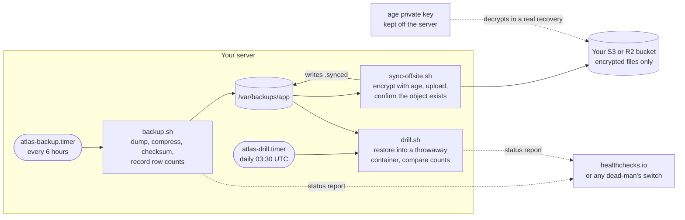

# Atlas

**Atlas proves your VPS backups restore: every day, automatically, without ever holding your keys.**

Most backup jobs report "success" when they write a file, not when the file can be restored. [Coolify's own docs](https://coolify.io/docs/databases/backups) put it plainly: "A successful backup only proves that Coolify created a file." Atlas is the step after that. Every night it restores each backup into a throwaway container running your production image, and checks that every table came back with the right number of rows.

```text
$ atlas restore drill glitchtip
  ✓ PASS Database restore executed without errors.
  ✓ PASS Verified 317 tables, 408,434 rows match the backup.
[SUCCESS] RESTORE DRILL PASSED for 'glitchtip' (163s).
```

- **Proof, not exit codes.** Row counts are recorded at dump time; truncated dumps are rejected; a failed drill names the table: `public.users has 1,234 rows, expected 1,300`.
- **Your keys stay yours.** Offsite copies are encrypted on the server with your age public key. The private key is never on the server, and no local backup is deleted until its offsite copy is confirmed.
- **It tells you when it can't tell you.** A heartbeat to healthchecks.io (or any dead-man's switch) alerts you when a backup is late, a drill fails, or the server goes quiet.
- **Fits what you run.** PostgreSQL, MySQL, MariaDB and MongoDB, plus Docker volumes and app folders. Works next to Coolify, Dokploy or plain Docker Compose. Bash and Python you can read in an evening; no inbound ports.

> **Design partners wanted.** We are looking for 10 people running real apps on a VPS to use Atlas free and tell us what breaks. We install it with you on a 30-minute call. [Open an issue titled "Design partner"](https://github.com/ignatius22/atlas/issues/new?title=Design%20partner) and we will get in touch.

## Install

On the server, as root:

```bash
curl -fsSL https://raw.githubusercontent.com/ignatius22/atlas/master/get.sh | sudo bash
```

In a few minutes it installs Atlas to `/opt/atlas`, finds the apps running in Docker, takes the first backup, restores it into a throwaway container to prove it works, and schedules backups every 6 hours plus a daily restore drill. It then lists what is left: offsite storage and a watchdog URL.

- **Encryption key.** At a terminal, the installer creates an age keypair, shows you the private key once and keeps only the public key on the server. For your own key or an unattended install, pass `--age-recipient=age1...` (from `age-keygen` on your laptop): `curl -fsSL .../get.sh | sudo bash -s -- --yes --age-recipient=age1...`
- **Safe to re-run.** Running it again upgrades the code and keeps your `.env`, `config/apps.yml` and dashboard token.
- **Options.** `--yes`, `--ref=v1.2.0`, `--dir=PATH`, `--no-first-run`, `--no-start`, `--no-deps`, `--no-discover`. Read the script before you pipe it: [`get.sh`](get.sh).

Requirements: Linux with systemd, Docker, Python 3. The installer adds `age` and `rclone` if they are missing.

## How it works



1. **Back up.** `backup.sh` dumps each database from inside its container (`pg_dump`, `mariadb-dump`/`mysqldump`, or `mongodump`), compresses it and writes a checksum. It reads every table's row count (or collection's document count) from the dump itself and stores it in `<archive>.manifest.json`. A dump that is empty or cut off is rejected and never replaces a good one. Docker volumes and folders listed under `files:` are archived the same way.
2. **Copy offsite.** `sync-offsite.sh` encrypts each archive with your age public key, uploads it with up to 3 attempts, then checks the object's size and checksum in the bucket. Only then does it write `<archive>.synced`. After an outage it uploads every archive still missing, oldest first.
3. **Prove it restores.** Each night `drill.sh` starts a throwaway container from the same image production runs, restores the newest backup into it, and compares every table's count with the manifest. The result is written to `<archive>.drill.json`, shown in the dashboard and alerted on failure. Production is never touched.
4. **Report.** After every backup and drill run, a short status report (no data, no keys) goes to your watchdog. Problems go to its failure URL, and silence trips it too.

Local retention deletes an archive only after it is past its retention period **and** has a `.synced` marker. If uploads fail for three weeks, you keep three weeks of local backups.

## Everyday commands

| Command | What it does |
| --- | --- |
| `atlas discover [--write]` | Proposes `apps.yml` entries from running containers; `--write` adds them (a backup copy of the file is kept) |
| `atlas backup create --all` | Backs up every app now (or name one app instead of `--all`) |
| `atlas backup sync --all` | Encrypts and uploads every archive not yet confirmed offsite |
| `atlas backup list myapp` | Lists the offsite archives for an app |
| `atlas restore drill [myapp]` | Restore-tests the newest backup of one app, or all apps |
| `atlas restore files myapp --to=DIR` | Extracts an app's files archive into a new directory; never touches live data |
| `atlas restore run myapp --target=production` | Restores into the production database after a safety backup and a typed confirmation |
| `atlas status` | Every app's newest backup, offsite copy and last drill, with any problems |
| `atlas heartbeat send` | Sends the watchdog report now |
| `atlas doctor` | Read-only check of the host, Docker, backups and timers |

Logs: `journalctl -u atlas-backup -n 100` and `journalctl -u atlas-drill -n 100`.

## Configuration

Apps live in `/opt/atlas/config/apps.yml`. `atlas discover --write` fills it in for you; this is what an entry looks like:

```yaml
apps:
  myapp:
    database:
      type: postgres          # postgres, mysql, mariadb or mongodb
      container: myapp_db
      name: myapp             # optional for MongoDB: every database is dumped by default
      user: myapp
      retention_days: 14      # default 14
    files:                    # optional: uploads and other data outside the database
      volumes: [myapp_uploads]
      paths: [/var/www/myapp/storage]
      exclude: ["cache", "*.log"]
      every_hours: 24         # default 24
      retention_days: 7       # default 7
```

Database passwords are never stored in Atlas. They are read inside each container from the image's standard variables (`POSTGRES_PASSWORD`, `MYSQL_ROOT_PASSWORD`, `MONGO_INITDB_ROOT_PASSWORD` and their equivalents) and never appear on a command line.

Server settings live in `/opt/atlas/.env` (mode 600):

| Variable | Purpose |
| --- | --- |
| `ATLAS_AGE_RECIPIENT` | Your age public key (`age1...`). Offsite copies are encrypted to it |
| `ATLAS_S3_BUCKET`, `ATLAS_S3_ENDPOINT`, `ATLAS_S3_ACCESS_KEY`, `ATLAS_S3_SECRET_KEY` | Any S3-compatible bucket: Cloudflare R2, AWS S3, Backblaze B2 |
| `ATLAS_HEARTBEAT_URL` | Your watchdog's ping URL. Problems go to `<URL>/fail` unless `ATLAS_HEARTBEAT_FAIL_URL` is set; `ATLAS_HEARTBEAT_SECRET` signs each report |
| `ATLAS_DISCORD_WEBHOOK`, `ATLAS_SLACK_WEBHOOK`, `ATLAS_TELEGRAM_BOT_TOKEN` + `ATLAS_TELEGRAM_CHAT_ID`, `ATLAS_GENERIC_WEBHOOK` | Failure alerts. Success alerts are off unless `ATLAS_NOTIFY_SUCCESS=true` |
| `ATLAS_DASHBOARD_TOKEN` | Required by the dashboard to run actions; the installer generates one |

## Recovering from a disaster

On a new server, install Atlas with the same `.env` and `apps.yml`, start your app containers, then restore from the bucket with the private key you kept off the server:

```bash
# See what is offsite
atlas backup list myapp

# Restore the newest offsite backup into a throwaway container first, to check it
ATLAS_AGE_IDENTITY="AGE-SECRET-KEY-1..." atlas restore test myapp

# Then into production
./scripts/restore-offsite.sh --app=myapp --key-file=/path/to/key.txt --target=production
```

To restore a local archive into production on the same server, use `atlas restore run myapp --target=production`. It takes a safety backup of the current database first and asks you to type `CONFIRM-RESTORE-TO-PRODUCTION`. [RECOVERY.md](RECOVERY.md) covers every case step by step, including files and a compromised server.

## Dashboard

A small web dashboard shows, per app, the chain from dump to drill: when it was backed up, whether it is offsite, and when it last passed a drill. It binds to `127.0.0.1:8888` only. Reach it through an SSH tunnel:

```bash
ssh -N -L 8888:127.0.0.1:8888 you@your-server   # then open http://localhost:8888
```

Viewing needs no token; running a backup, upload or drill from the page asks for `ATLAS_DASHBOARD_TOKEN`. See [dashboard/README.md](dashboard/README.md).

## Design decisions

**Why the `.synced` marker is a file.** It is created by an atomic rename only after the bucket listing shows the object, so a crash at any point leaves either no marker or a valid one. Retention checks for the file, not a status in memory.

**Why systemd timers, not cron.** With `Persistent=true`, a run missed while the server was off happens as soon as it boots. Cron skips it silently.

**Why separate locks.** Backups, uploads and drills each hold their own kernel lock (`flock`) under `/run/atlas`. A slow upload never blocks the next backup, and a crashed process cannot leave a stale lock behind. Uploads read only finished archives, because dumps are written to a temporary file and renamed when complete.

**Why the drill uses the production image.** A dump from Postgres 16 is restored on Postgres 16, not on whatever the test image happens to be. Override it per app with `database.restore_image`.

**What Atlas does not do.** No point-in-time recovery: you can lose up to 6 hours of writes, or more if the server is down. No Kubernetes, managed databases (RDS, Neon, Supabase cloud) or Windows. For point-in-time recovery on a busy Postgres, use a WAL-based tool such as pgBackRest or WAL-G alongside Atlas.

## Repository layout

| Path | Contents |
| --- | --- |
| `get.sh` | One-line installer |
| `bin/atlas`, `bin/doctor` | CLI and read-only diagnostics |
| `scripts/` | `backup.sh`, `sync-offsite.sh`, `drill.sh`, `restore.sh`, `restore-offsite.sh`, `restore-files.sh`, `install.sh` |
| `scripts/lib/` | Dump manifests, files archives, discover, heartbeat, notifications |
| `systemd/` | Backup and drill services and timers |
| `dashboard/` | Python API (`server.py`) and React app; the build in `dist/` is committed so servers need no Node.js |
| `config/` | `apps.example.yml` |
| `tests/` | `run-all.sh` plus one suite per area, run in CI against PostgreSQL 14, 15 and 16, MySQL, MariaDB and MongoDB |

The repository also carries the deployment helpers we use on our own servers (`deploy.sh`, `rollback.sh`, `setup-ssl.sh`, `infra/nginx`). They are optional and not part of the backup path.

## Documentation

| Doc | For |
| --- | --- |
| [User guide](docs/USER_GUIDE.md) | Installing, adding apps, offsite storage, drills, alerts, every command |
| [Recovery](RECOVERY.md) | Rolling back a database, restoring files, rebuilding a lost server |
| [Troubleshooting](TROUBLESHOOTING.md) | What an error means and how to fix it |
| [Security](SECURITY.md) | The security model, and how to report a vulnerability |
| [Deploy helpers](docs/DEPLOYMENT.md) | The optional deploy, rollback and TLS scripts |
| [Changelog](CHANGELOG.md) | What changed |

## Contributing

Run the tests with `make test` (Docker is needed for the end-to-end suites). See [CONTRIBUTING.md](CONTRIBUTING.md).

## License

[Apache License 2.0](LICENSE).
